**Web Engineer · Frontend-focused · AI training environments**

I was introduced to web development in college. I started with HTML, like most people do, and slowly moved from simple pages to building complete interfaces. At some point, I realized I could spend an entire day tweaking a component or perfecting a page without noticing how much time had passed. That's when I knew web engineering was more than just another skill I was learning — I genuinely enjoyed it.

I went on to work with a couple of startups as a frontend developer, building real products and learning how things work outside tutorials and coursework. When the AI boom started changing the way we build software, I began exploring ChatGPT, Codex, OpenCode, Cursor, Claude, and other AI-powered development workflows. Today I work remotely with an international company, building web interfaces used to train and evaluate AI agents.

My work has involved high-fidelity search, filtering, booking, e-commerce, and enterprise interfaces, often recreating complex real-world workflows where the details matter. I'm particularly interested in the intersection of web engineering and AI: building interfaces that use AI efficiently to create better user experiences, and realistic interfaces designed specifically for training and evaluating AI systems.

- **Currently:** Team Lead at **Devitron Solutions** (Sep 2025 – Present), leading teams, reviewing code, and mentoring team members.
- **Role history:** Senior Frontend Engineer at **Devitron Solutions** (Dec 2024 – Sep 2026), building high-fidelity web applications for AI training datasets.
- **Toolkit:** React.js, Next.js, JavaScript, HTML, CSS, Python, Django, Azure, SQLite, Figma, and Slack.
- **AI workflows:** ChatGPT, Codex, OpenCode, Cursor, Claude.
- **Languages:** English and Urdu.

| Role | Company | Period | Selected work |
| :--- | :--- | :--- | :--- |
| **Team Lead** | **Devitron Solutions** Punjab, Pakistan · Remote · Full-time | Sep 2025 – Present | • Leading teams, conducting code reviews, and mentoring team members. • Building high-fidelity web applications for AI training datasets. • Collaborating on data-handling and various workflows. |
| **Senior Frontend Engineer** | **Devitron Solutions** Punjab, Pakistan · Remote · Full-time | Dec 2024 – Sep 2026 | • Developed high-fidelity web applications for AI training datasets. • Built search, filtering, booking, e-commerce, and enterprise interfaces. • Collaborated on data-handling and various workflows. |
| **Web Engineer** | **Freelance / Self-Employed** Punjab, Pakistan · Remote · Freelance | Sep 2023 – Oct 2024 | • Built and maintained React-based Chrome extensions using Plasmo. • Developed browser-based features and workflow automation. • Worked with REST APIs, IndexedDB, Git/GitHub, and full-stack data flows. |
| **Frontend Developer** | **HeLLLoDEV** Punjab, Pakistan · Hybrid · Part-time | Mar 2023 – Jul 2023 | • Developed responsive web applications using Next.js and Tailwind CSS. • Translated UI/UX designs into functional features and integrated APIs. • Followed modern Git/GitHub development practices. |

A selection of high-fidelity builds from my portfolio. Each one recreates real product workflows so AI agents can be trained and evaluated on realistic web interactions.

| Project | What it does | Stack | Case study |
| :--- | :--- | :--- | :--- |
| **Outreach Enterprise Platform** | Large-scale reconstruction of Outreach's enterprise platform; I led the build, coordinated the team, and kept workflows consistent. | React · TypeScript | [View](https://abdulrafayahmadv2.vercel.app/work/outreach-enterprise) |
| **Southwest Airlines Booking Flow** | Pixel-faithful five-step booking flow from homepage search through passenger details and pricing. | React · TypeScript · Tailwind CSS | [View](https://abdulrafayahmadv2.vercel.app/work/southwest-booking) |
| **Hipcamp Search Experience** | Functional campsite search with destination and road-trip patterns, filtering, and results. | React · Vite · React Router | [View](https://abdulrafayahmadv2.vercel.app/work/hipcamp-search) |
| **Trivago Hotel Filtering UI** | High-fidelity hotel results and filtering UI with server-rendered data and client-side filters. | Next.js · TypeScript | [View](https://abdulrafayahmadv2.vercel.app/work/trivago-filtering) |

More case studies: [abdulrafayahmadv2.vercel.app/work](https://abdulrafayahmadv2.vercel.app/work)

**Backend**

**Frontend**

**Cloud & DevOps**

**Databases**

**Tools**

**AI workflows:** ChatGPT · Codex · OpenCode · Cursor · Claude

| Area | What I bring |
| :--- | :--- |
| **Frontend engineering** | React.js, Next.js, JavaScript, HTML, and CSS for responsive, production-ready interfaces. |
| **High-fidelity UI** | Pixel-perfect implementation of search, filtering, booking, e-commerce, and enterprise workflows. |
| **AI training environments** | Realistic web surfaces built to train and evaluate AI agents on multi-step interactions. |
| **AI-assisted development** | Using ChatGPT, Codex, OpenCode, Cursor, Claude, and other AI-powered workflows in day-to-day development. |
| **Team leadership** | Leading teams, conducting code reviews, and mentoring team members. |
| **Data handling** | REST APIs, IndexedDB, and full-stack data flows. |
| **Design handoff** | Translating UI/UX designs into functional features. |
| **Collaboration tools** | Figma and Slack. |
| **Languages** | English and Urdu. |

| Program | Institution | Period |
| :--- | :--- | :--- |
| **Bachelor of Science in Computer Science (BSCS)** | Virtual University of Pakistan | 2024 – 2027 |
| **Bachelor of Science in Computer Science (BSCS)** | COMSATS University | 2023 – 2024 |

For collaborations, questions, or a closer look at my work:

Thanks for stopping by. Built with care by Abdul Rafay · 2026

